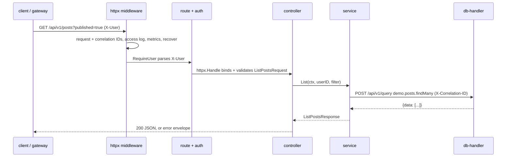

# go-backend-template

Starting point for a new Go service in the `go-backend-*` family. Clone it, rename it, delete the example `posts` feature once you have your own.

## Start a new service

```sh
gh repo create ahmedbaig/orders --template ahmedbaig/go-backend-template --public --clone
cd orders
scripts/new-service.sh orders            # rewrites module path, names and config file names
make setup                               # copies configs/*.sample into ./var
make test
make run
```

## Layout

```
cmd/server/main.go            load config + logger → build context → register routes → run
api/                          separate module: request/response types + typed client for other services
internal/
  config/                     typed config (<name>.json, <name>-logger.json) and defaults
  appctx/                     the service context: config, logger, prober, db client, outbound http client
  http/
    routes/                   URL → middleware → controller, one Group per area
    controllers/              one method per endpoint: read the user, call a service, shape the response
    services/                 business logic and calls to db-handler / other services
configs/*.json.sample         sample config, copied to ./var by make setup
Dockerfile, make/go.mk,       from go-backend-pipelines
deploy.sh, .gitlab-ci.yml,
.github/workflows/ci.yml
VERSION                       image tag version (<branch>-<VERSION>)
```

## Request flow



## Adding an endpoint

1. Request/response types in `api/types.go` with `json`, `query`, `path` and `validate` tags, plus a method on `api.Client`.
2. Service method in `internal/http/services` using the generated table types (`demo.PostService(client)`, `demo.PostFields.Title`) from `go-backend-db-handler/types`. Map upstream errors to `httpx.E(...)` codes.
3. Controller method `func (c *X) Name(ctx, in Req) (Res, error)`.
4. Route in `internal/http/routes`: `group.Post("/path", httpx.Handle(c.Name))`.
5. Test in `cmd/server/main_test.go` style: `testkit.NewStub` for db-handler, `testkit.NewClient` for the app.

## Types: where they live

| Kind | Package | Shared how |
|---|---|---|
| table structs, field names, typed db services | `github.com/ahmedbaig/go-backend-db-handler/types/<database>` | generated by db-gen |
| user session, paging, sorting, error wire format, JSON client | `github.com/ahmedbaig/go-backend-types` | hand-written, tiny, stdlib only |
| this service's requests, responses and client | `github.com/ahmedbaig/go-backend-template/api` | nested module, tag `api/vX.Y.Z` |

Another service calls this one with:

```go
posts := api.NewClient("http://template:8080", client.ForwardUser(), client.WithIDs(httpx.IDs))
list, err := posts.ListPosts(ctx, api.ListPostsRequest{PageRequest: types.PageRequest{Take: 10}})
```

## Endpoints in the example

| Route | |
|---|---|
| `GET /api/v1/posts?published=&q=&take=&skip=` | the caller's posts |
| `POST /api/v1/posts` | create (201) |
| `GET /api/v1/posts/{id}` | one post, 404 if not the caller's |
| `PATCH /api/v1/posts/{id}` | partial update |
| `DELETE /api/v1/posts/{id}` | 204 |
| `GET /api/v1/admin/info` | `admin` role only |
| `GET /healthz`, `/healthp`, `/readyz`, `/metrics` | from go-backend-http |

Every `/api/v1` route needs the `X-User` header (`{"id":7,"email":"...","roles":["admin"]}`), which the gateway adds after authenticating. For local testing: `curl -H 'X-User: {"id":1,"roles":["admin"]}' localhost:8080/api/v1/posts`.

## Config

`CONFIG_DIR` (default `/app/var/secrets`, `./var` with `make run`) holds `go-backend-template.json` and `go-backend-template-logger.json`, or set `GO_BACKEND_TEMPLATE_SECRET` / `GO_BACKEND_TEMPLATE_LOGGER_SECRET` to the JSON. See `configs/*.sample`.

## Commands

`make help`. The usual ones: `make test`, `make check` (what CI runs), `make run`, `make docker && make docker-run`, `./deploy.sh`.

## License

MIT
