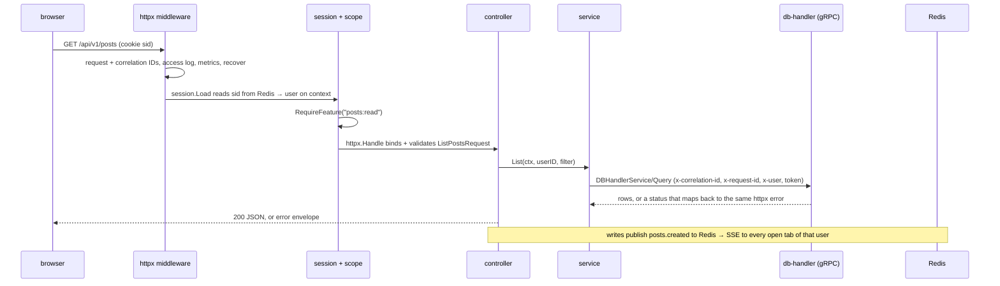

# go-backend-template

Starting point for a new Go service in the `go-backend-*` family, and a reference for how the pieces fit: REST in, gRPC to db-handler, Redis sessions, live updates over SSE, scopes, background jobs. Clone it, rename it, delete the example `posts` feature once you have your own.

## Start a new service

```sh
gh repo create ahmedbaig/orders --template ahmedbaig/go-backend-template --public --clone
cd orders
scripts/new-service.sh orders            # rewrites module path, names and config file names
make setup                               # copies configs/*.sample into ./var
docker compose up -d redis               # sessions and live events
make test
make run                                 # needs db-handler on :9090 (go-backend-db-handler: make run)
```

## Layout

```
cmd/server/main.go            load config + logger → server.Build → run
api/                          separate module: constants.go (paths, scopes, topics, roles), types.go, typed client for other services
internal/
  constants/                  app-wide constants: name, environments, probe names, Redis keys, timings
  config/                     typed config (<name>.json, <name>-logger.json, version) and defaults
  server/                     Build: context → HTTP app → routes → jobs
  appctx/                     the service context; context.go holds it, db.go and redis.go build each piece
  session/                    Redis sessions: cookie → user on the context, Require(), cookie helpers
  events/                     Redis pub/sub broker with stream replay, topic ACL (scope + per-user channels)
  jobs/                       background jobs on an interval with jitter, timeout and their own correlation ID
  http/
    routes/                   api paths → middleware → controller
    controllers/              one method per endpoint: read the user, call a service, shape the response
    services/                 business logic and calls to db-handler / other services
test/e2e/                     end-to-end tests through server.Build
configs/*.json.sample         sample config, copied to ./var by make setup
compose.yaml                  local Redis
Dockerfile, make/go.mk,       from go-backend-pipelines
deploy.sh, .gitlab-ci.yml,
.github/workflows/ci.yml
VERSION                       image tag version (<branch>-<VERSION>)
```

Rules: every package keeps its type declarations in `types.go` and the other files hold functions and methods. Constants shared across packages live in `internal/constants`; the REST contract's constants live in `api/constants.go`. One `_test.go` per package for unit tests, end-to-end tests in `test/e2e`. The running version comes from `version` in the config file.

## Request flow



The correlation ID from the browser (or a new one) is in every log line here and in db-handler, and inside each published event.

## Sessions and scopes

Sessions are an opaque `sid` cookie (HttpOnly, SameSite=Lax, optional parent `cookieDomain` so one login covers every subdomain) pointing at the user in Redis, with a sliding TTL. Scopes are the user's `features`, checked per route with `httpx.RequireFeature("posts:write")`; roles with `httpx.RequireRole("admin")`. A real login (OIDC) only has to call `Sessions.Create(user)` and set the cookie. Until then, dev-login is the stand-in, available only when `session.devLogin` is on and the environment is `localhost` or `testing`.

```sh
curl -c jar -H 'content-type: application/json' localhost:8080/api/v1/session/dev-login \
  -d '{"email":"me@example.com","name":"Me","features":["posts:read","posts:write"]}'
curl -b jar localhost:8080/api/v1/posts
curl -b jar -N -H 'accept: text/event-stream' 'localhost:8080/api/v1/events?topics=posts'
```

## Live updates

`GET /api/v1/events?topics=posts` is a server-sent event stream. Topics are declared once in `appctx` with the scope they need and whether they are per user (`posts` becomes channel `posts:<userId>`). Publishing:

```go
c.events.PublishOrLog(ctx, events.UserChannel(api.TopicPosts, u.ID), api.EventPostCreated, post)
```

Each publish goes into a capped Redis stream and out on pub/sub. Subscribers get live messages from pub/sub. When the browser reconnects with `Last-Event-ID`, the missed events are replayed from the stream first, without duplicates. The event body is the `events.v1.Event` envelope from [go-backend-proto](https://github.com/ahmedbaig/go-backend-proto): `{id, topic, type, data, correlationId, requestId, at}`. Streams send a `: ping` every 15 s and end cleanly on shutdown. nginx in front needs `proxy_buffering off` on this route.

## Background jobs

`jobs.Runner` runs functions on an interval with jitter, a timeout, panic recovery and a fresh correlation ID per run, and stops with the app. The example refreshes db-handler capabilities every 10 minutes. Keep polling jobs on servers and at sensible intervals; nothing should saturate the network.

## Adding an endpoint

1. Request/response types in `api/types.go` with `json`, `query`, `path` and `validate` tags, plus a method on `api.Client`.
2. Service method in `internal/http/services` using the generated table types (`demo.PostService(client)`, `demo.PostFields.Title`) from `go-backend-db-handler/types`. Map upstream errors to `httpx.E(...)` codes.
3. Controller method `func (c *X) Name(ctx, in Req) (Res, error)`.
4. Route in `internal/http/routes`: `group.Post("/path", httpx.Handle(c.Name), httpx.RequireFeature("<area>:write"))`.
5. If the change should show up live, publish an event after the write.
6. Test in `cmd/server/main_test.go` style: miniredis for Redis, `testkit.NewStub` (HTTP) or a fake `DBHandlerService` (gRPC) for db-handler, `login(...)` for a session.

## Types: where they live

| Kind | Package | Shared how |
|---|---|---|
| table structs, field names, typed db services | `github.com/ahmedbaig/go-backend-db-handler/types/<database>` | generated by db-gen |
| user session, paging, sorting, error wire format, JSON client | `github.com/ahmedbaig/go-backend-types` | hand-written, tiny, stdlib only |
| gRPC contracts, event envelope | `github.com/ahmedbaig/go-backend-proto` | protos + generated code |
| this service's requests, responses, scopes, topics and client | `github.com/ahmedbaig/go-backend-template/api` | nested module, tag `api/vX.Y.Z` |

Another service calls this one with:

```go
posts := api.NewClient("http://template:8080", client.ForwardUser(), client.WithIDs(httpx.IDs))
list, err := posts.ListPosts(ctx, api.ListPostsRequest{PageRequest: types.PageRequest{Take: 10}})
```

## Endpoints in the example

| Route | Needs |
|---|---|
| `GET /api/v1/session` | a session, returns `{user}` |
| `POST /api/v1/session/dev-login` | dev-login on: `{email, name, roles, features}` sets the cookie |
| `DELETE /api/v1/session` | logs out |
| `GET /api/v1/events?topics=posts` | SSE, `posts:read` |
| `GET /api/v1/posts?published=&q=&take=&skip=` | `posts:read`, the caller's posts |
| `POST /api/v1/posts` | `posts:write`, 201 and a `posts.created` event |
| `GET /api/v1/posts/{id}` | `posts:read`, 404 if not the caller's |
| `PATCH /api/v1/posts/{id}` | `posts:write`, `posts.updated` event |
| `DELETE /api/v1/posts/{id}` | `posts:write`, 204 and a `posts.deleted` event |
| `GET /api/v1/admin/info` | `admin` role |
| `GET /healthz`, `/healthp`, `/readyz`, `/metrics` | from go-backend-http, with probes for db-handler (gRPC health) and Redis |

## Config

`CONFIG_DIR` (default `/app/var/secrets`, `./var` with `make run`) holds `go-backend-template.json` and `go-backend-template-logger.json`, or set `GO_BACKEND_TEMPLATE_SECRET` / `GO_BACKEND_TEMPLATE_LOGGER_SECRET` to the JSON. See `configs/*.sample`.

| Key | |
|---|---|
| `dbHandler.transport` | `grpc` (default, `grpcAddr`) or `http` (`url`); `apiKey` is the service token either way |
| `redis` | address, credentials, key `prefix` |
| `session` | cookie name and parent domain, `secure`, `ttl`, `devLogin` |
| `events` | stream length kept for replay, heartbeat |
| `jobs` | intervals; `0` turns a job off |
| `corsOrigins` | the frontends allowed to call with cookies |

## Commands

`make help`. The usual ones: `make test`, `make check` (what CI runs), `make run`, `make docker && make docker-run`, `./deploy.sh`.

## License

MIT
